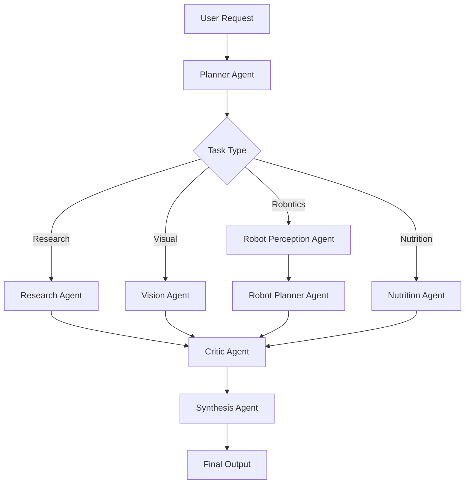

# Multi-Agent Orchestrator

A modular, graph-driven multi-agent pipeline that coordinates specialized AI agents — research, vision, robotics, and nutrition planning — through a central orchestrator, with a critic/synthesis step to produce a final, quality-checked output.

## Overview

This project implements an orchestration layer that routes a user request through a **Planner**, dispatches it to one or more **specialized agents** depending on the task (web research, image/video understanding, robot perception & planning, nutrition planning), passes the results through a **Critic** for quality control, and merges everything with a **Synthesis Agent** into the final response.

State is passed between nodes using a shared schema (`state/schema.py`), and the whole flow is wired together as a state graph in `graph/orchestrator.py`.

## Key Features

- **Multi-agent architecture** — each agent is a self-contained module with a single responsibility.
- **Graph-based orchestration** — agents are wired together as nodes in a directed graph rather than hardcoded call chains, making the flow easy to extend.
- **Web research** via a dedicated Tavily search client (`llm/tavily_client.py`).
- **Vision & robotics support** — frame annotation (`annotator.py`), vision agent, and robot perception/planning agents for visual and embodied tasks.
- **Tool integrations** — Excel export/import (`tools/excel_tool.py`) and video processing utilities (`utils/video_utils.py`).
- **Critic + Synthesis pass** — outputs are reviewed for quality before being merged into a final answer.
- **Structured logging** — run logs written to `logs/orchestrator.log`.

## Architecture



## Project Structure

```
multi_agent_orchestrator/
├── .env                        # Environment variables / API keys (not committed)
├── README.md
├── requirements.txt            # Python dependencies
├── main.py                     # Entry point — runs the orchestrator pipeline
├── annotator.py                # Draws annotations (e.g. bounding boxes) on frames
├── annotated_frame.jpg         # Sample output from the annotator
├── debug_llm.py                # Ad-hoc script for debugging the LLM client
├── debug_llm2.py               # Additional LLM debugging/testing script
├── agents/
│   ├── __init__.py
│   ├── planner.py              # Decomposes requests and routes tasks to agents
│   ├── research_agent.py       # Performs web research (via Tavily)
│   ├── vision_agent.py         # Handles image/video understanding tasks
│   ├── robot_perception_agent.py # Processes sensor/visual input for robotics tasks
│   ├── robot_planner_agent.py  # Plans robot actions based on perception output
│   ├── nutrition_agent.py      # Generates nutrition-related recommendations/plans
│   ├── critic.py               # Reviews agent outputs for quality/consistency
│   └── synthesis_agent.py      # Merges agent outputs into the final response
├── graph/
│   ├── __init__.py
│   └── orchestrator.py         # Defines and runs the multi-agent state graph
├── llm/
│   ├── __init__.py
│   ├── client.py               # Wrapper around the LLM provider API
│   └── tavily_client.py        # Client for the Tavily web search API
├── state/
│   ├── __init__.py
│   └── schema.py               # Shared state schema passed between graph nodes
├── tools/
│   ├── __init__.py
│   └── excel_tool.py           # Read/write helper for Excel-based inputs/outputs
├── utils/
│   ├── __init__.py
│   └── video_utils.py          # Video loading, frame extraction, and processing helpers
└── logs/
    └── orchestrator.log        # Runtime logs
```

> Note: the local `.venv`/`venv` virtual environment directories are excluded from version control and from this tree — see [Installation](#installation) to recreate them.

## Prerequisites

- Python 3.12+
- A virtual environment tool (`venv`, `virtualenv`, or `uv`)
- API keys for:
  - Your LLM provider (used by `llm/client.py`)
  - [Tavily](https://tavily.com/) (used by `llm/tavily_client.py` for web research)

## Installation

```bash
# Clone the repository
git clone <repository-url>
cd multi_agent_orchestrator

# Create and activate a virtual environment
python3 -m venv .venv
source .venv/bin/activate       # On Windows: .venv\Scripts\activate

# Install dependencies
pip install -r requirements.txt
```

## Configuration

Create a `.env` file in the project root with the required API keys and settings:

```env
# LLM provider credentials
LLM_API_KEY=your_llm_api_key_here

# Web research
TAVILY_API_KEY=your_tavily_api_key_here

# Optional overrides
LOG_LEVEL=INFO
```

> Replace the variable names above with the exact keys expected by `llm/client.py` and `llm/tavily_client.py` if they differ.

## Usage

Run the full orchestrator pipeline:
```bash
python main.py
```

Debug or test the LLM client in isolation:
```bash
python debug_llm.py
python debug_llm2.py
```

Generate annotated output from a frame/image (used by the vision/robot perception agents):
```bash
python annotator.py
```

## Agents

| Agent | File | Responsibility |
|---|---|---|
| Planner | `agents/planner.py` | Breaks down the incoming request and decides which agent(s) to invoke |
| Research Agent | `agents/research_agent.py` | Gathers external information via web search (Tavily) |
| Vision Agent | `agents/vision_agent.py` | Interprets images/video frames |
| Robot Perception Agent | `agents/robot_perception_agent.py` | Extracts structured perception data for robotics tasks |
| Robot Planner Agent | `agents/robot_planner_agent.py` | Plans robot actions based on perception output |
| Nutrition Agent | `agents/nutrition_agent.py` | Produces nutrition-related analysis or recommendations |
| Critic | `agents/critic.py` | Evaluates and flags issues in agent outputs before synthesis |
| Synthesis Agent | `agents/synthesis_agent.py` | Combines validated outputs into the final response |

## Core Modules

- **`graph/orchestrator.py`** — Defines the state graph connecting all agents and controls execution flow.
- **`state/schema.py`** — Defines the shared state object/schema passed between graph nodes.
- **`llm/client.py`** — Central LLM API wrapper used across agents.
- **`llm/tavily_client.py`** — Wrapper around the Tavily search API for the Research Agent.
- **`tools/excel_tool.py`** — Utility for reading/writing Excel files (e.g. structured inputs/reports).
- **`utils/video_utils.py`** — Helpers for loading video and extracting frames for the vision pipeline.

## Logging

Execution logs are written to `logs/orchestrator.log`. Adjust verbosity via the `LOG_LEVEL` environment variable in `.env`.

## Contributing

1. Fork the repository and create a feature branch.
2. Make your changes, adding/updating tests where relevant.
3. Open a pull request describing the change and its motivation.

## License

<Specify your license here, e.g. MIT, Apache-2.0>
